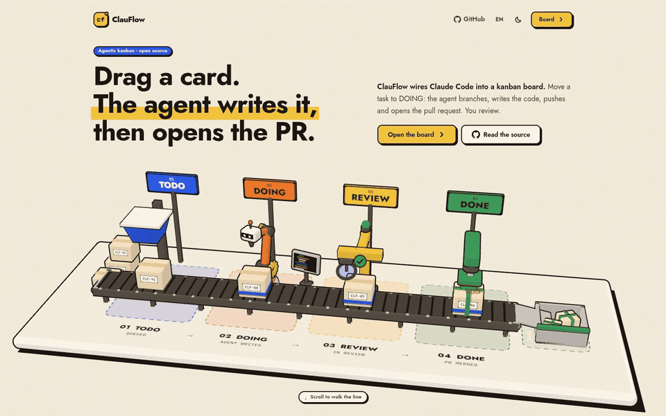
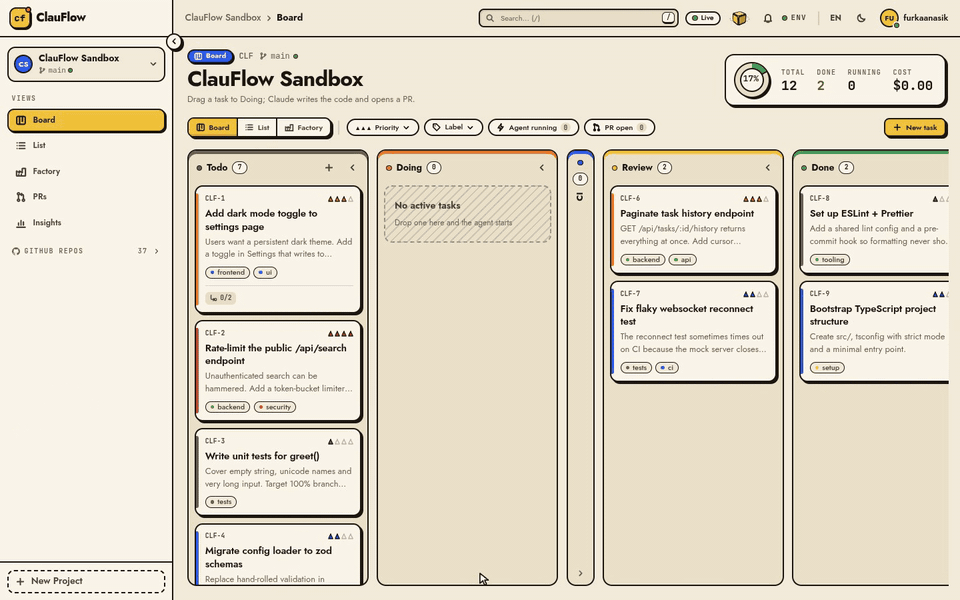
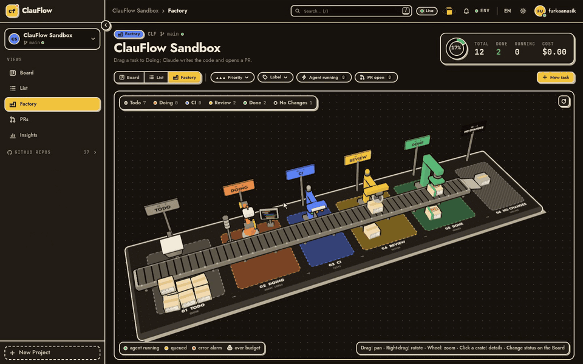
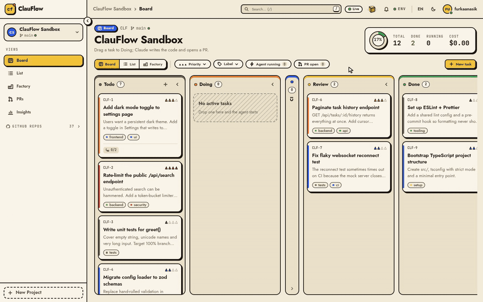
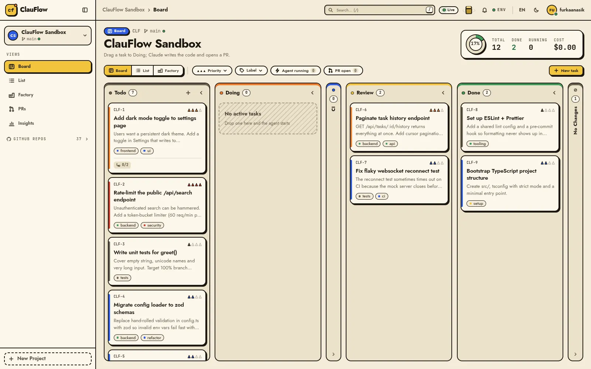
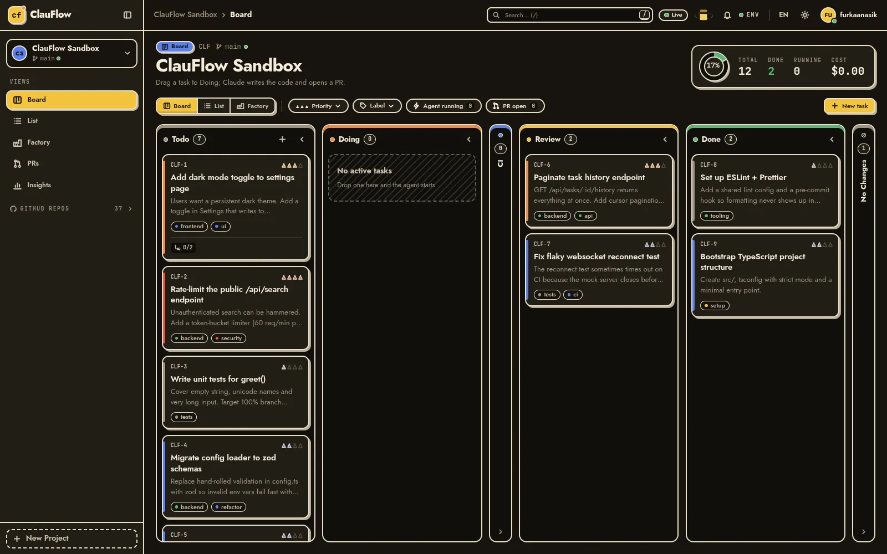
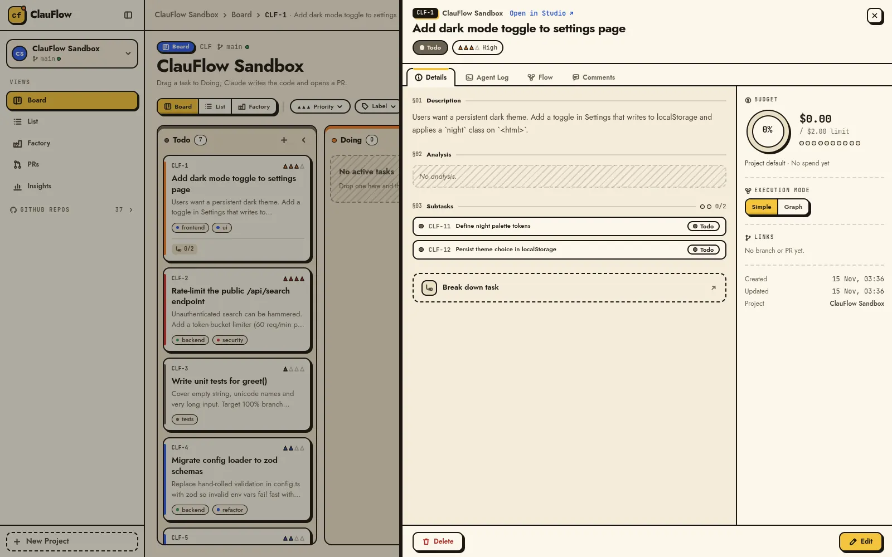
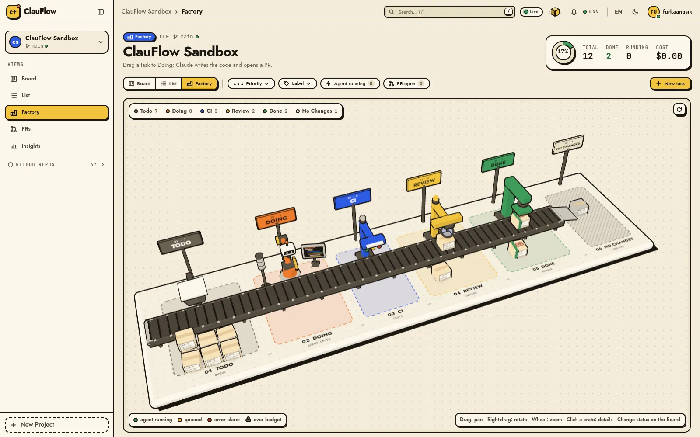
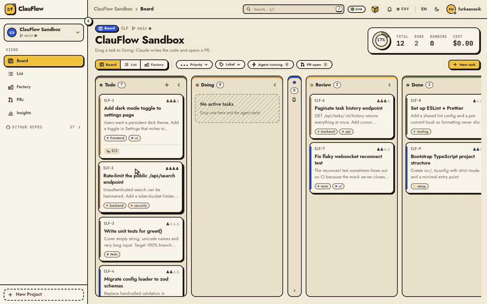

<div align="center">

# ClauFlow

**Drag a task. The agent ships the PR.**

An open-source agentic kanban board. Move a card to **DOING** and the Claude Code CLI branches, writes the code, commits, pushes and opens a pull request. Comment in **REVIEW** and Claude re-runs on the same branch.



[](https://github.com/furkaanasik/ClauFlow/releases)
[](#architecture)
[](https://docs.claude.com/en/docs/claude-code/overview)
[](#license)

[Quickstart](#quickstart) · [How it works](#how-it-works) · [Design system](DESIGN.md) · [Architecture notes](CLAUDE.md) · [Issues](https://github.com/furkaanasik/ClauFlow/issues)

</div>

---

## Contents

1. [What is ClauFlow?](#what-is-clauflow)
2. [How it works](#how-it-works)
3. [Feature tour](#feature-tour)
4. [Quickstart](#quickstart)
5. [Configuration](#configuration)
6. [Architecture](#architecture)
7. [Design system](#design-system)
8. [Scripts](#scripts)
9. [Contributing](#contributing)
10. [License](#license)

---

## What is ClauFlow?

ClauFlow (**Clau**de + work**Flow**) turns a kanban board into an autonomous development pipeline. You describe the work as a task. Moving the card across columns drives a real git, Claude and `gh` workflow behind the scenes.

Most "agentic" tools are chat boxes with extra steps: you paste a prompt, watch text scroll by and copy back the diff. ClauFlow puts the agent **inside** the workflow you already use instead.

| Idea | In ClauFlow |
|---|---|
| A unit of work | a kanban card |
| A unit of review | a pull request |
| The interface | the board, with no chat and no copy-paste |
| Your job | drag, comment, merge |

---

## How it works

```
TODO ──▶ DOING ──▶ REVIEW ──▶ DONE
           │          │          │
         agent     human +     gh pr
         codes     comments    merge
```

| Column | Trigger | What happens |
|---|---|---|
| **TODO** | You add a card or let the AI planner fill the board | Title, description, analysis and priority become the agent's work order. |
| **DOING** | You drag the card here | The executor checks out the base branch, creates `feature/<id>-<title-slug>`, runs the task's team (one `claude -p` call per role, committing between roles), pushes and opens a PR with `gh pr create`. |
| **REVIEW** | Automatic, when the team delivers | You read the diff (the built-in PR viewer, or the task's **Changes** tab when there is no PR) and comment, and each comment re-runs Claude on the **same branch** as new commits. No new PR is opened. |
| **DONE** | You drag the card here | With a PR: `gh pr merge --merge --delete-branch`. Without a remote: a local `git merge --no-ff` into the base branch, then the branch is deleted. A conflict aborts the merge and the card stays in **REVIEW**. |

- **No remote:** no push and no PR; the task still lands in **REVIEW** on its local branch, with the diff against base in the task drawer.
- **Executor failure:** the task returns to **TODO** with the agent error attached.
- **Live updates:** every step (checkout, prompt, tool calls, commit, push, PR) streams over WebSocket into the task's Agent Log.

---

## Feature tour

### Board and task drawer



| Feature | Details |
|---|---|
| **Board, List, Factory views** | Trello-style columns with drag and drop, a Jira-style table, and a live 3D factory. |
| **Task drawer** | Tabs for Details, Agent Log, Team and Comments, plus a budget gauge, a "Who does this task?" team picker and AI "Break down task" into subtasks. The Team tab reads like a conversation: brief, spec, delivery note and QA verdict per round, with a spec-approval gate when the project asks for one. |
| **Live agent logs** | Tool-call traces and token / cost observability per run. |
| **Built-in PR viewer** | Full-screen drawer with a side-by-side diff, file tree, per-file collapse and Mark viewed. |
| **Insights** | Per-project token spend, cost, completion and average run time, exportable as JSON or CSV. |
| **Keyboard** | `N` new task, `/` search, `?` shortcut help, `Esc` closes the top layer. |

### Fabrika: the factory view



Every task is a crate on a conveyor, with one station per column. Crates move between stations as the agent works. Drag to pan, right-drag to rotate, scroll to zoom, and click a crate for its details. Browsers without WebGL fall back to a printed 2D factory.

The left rail collapses to an icon rail with the round handle on its edge. The state is remembered in `localStorage`.

### Cream paper and night shift



| Board (cream) | Board (night shift) |
|---|---|
|  |  |
| **Task drawer** | **Factory view (3D)** |
|  |  |

The **Atölye** look is a printed workshop: cream paper, 2px ink rules, hard offset shadows, mustard actions and cobalt section pills, set in Jost and JetBrains Mono. Theme (`cream` / `night`) and language (EN / TR) are one click away and persist in `localStorage`.

### New project, folder picker and AI planner



| Step | What you get |
|---|---|
| **Browse** | A folder picker with breadcrumbs, keyboard navigation (`↑↓` move, `Enter` open, `⌫` up), a "git" badge on repositories, hidden-folder toggle and New folder. Choosing a folder fills Repo Path, Name and Slug. |
| **Non-git folder** | ClauFlow creates the folder if needed, runs `git init` on the default branch, adds a `README.md` if missing and makes an initial commit. |
| **Create GitHub repository** | Optionally creates the remote with `gh repo create` (private or public). |
| **AI Prompt** | Describe the project and the planner agent splits it into tasks. A banner on the board shows progress and elapsed time. If planning fails, edit the AI Prompt in project details and save to retry. |
| **Clone from GitHub** | The rail lists your repos via `gh repo list`. Click one to clone it as a new project. |

### Project control panel

Each project gets a Claude Config drawer with two segments:

| Segment | What it does |
|---|---|
| **Instructions** | `CLAUDE.md` split editor with a live Markdown preview. Saving commits it only while the repo is on its base branch. A prereq banner checks the `claude` / `git` / `gh` versions and offers copy-paste install commands. |
| **Team** | The team editor. A team is an ordered list of roles (CEO → Analyst → Developer ⇄ QA) that run one after another, with one feedback loop from QA back to the Developer. Built-in teams (Solo, Software Team, Bug Hunt, Exploration) are read-only; **Customize** copies one into the project. Each role has instructions, a model, an optional advisor model, allowed tools and skills (user, project and plugin skills, injected into the role's prompt). Project settings: the default team, the QA round limit (a number or Unlimited) and the spec-approval gate. Teams live in ClauFlow's database and are never written to your repo. The **Skill manager** (Installed / Registry / Marketplaces, backed by the real `claude plugin` CLI) opens from here. |

---

## Quickstart

### Prerequisites

ClauFlow shells out to two CLIs at runtime. Install and authenticate both **before** you start the backend.

| CLI | Why it's needed | Install | Auth |
|---|---|---|---|
| **Claude Code** (`claude`) | Runs the code generation in every executor and comment task | [docs.claude.com/claude-code](https://docs.claude.com/en/docs/claude-code/overview) | `claude` (the first run prompts a login) |
| **GitHub CLI** (`gh`) | Clones repos, sets up git credentials, opens and merges PRs | macOS: `brew install gh` · Arch/CachyOS: `sudo pacman -S github-cli` · Debian/Ubuntu: see [cli.github.com](https://cli.github.com) | `gh auth login`, then `gh auth setup-git` |

You also need **Node.js 20+** (`better-sqlite3` 12 requires it), **pnpm**, and **Git** with a configured identity.

```bash
claude --version
gh auth status
node --version
```

### Install and run

```bash
# Backend: Express + WebSocket on :3001 (npm)
cd core && npm install && npm run dev

# Frontend: Next.js on :3000 (pnpm), in a second terminal
cd gui && pnpm install && pnpm dev
```

> `core/` uses **npm** and `gui/` uses **pnpm**. Don't cross them. If pnpm isn't installed globally, use the version pinned in `gui/package.json`: `npx pnpm@11.0.9 install` and `npx pnpm@11.0.9 dev`.

Open <http://localhost:3000>, create or clone a project, drop a card on **DOING** and watch the agent work.

---

## Configuration

Every variable is optional. The defaults below run a local setup without any env file.

### `gui/` (`gui/.env.local`)

| Variable | Default | Notes |
|---|---|---|
| `NEXT_PUBLIC_API_BASE` | `http://localhost:3001/api` | REST base URL. Baked in at build time. |
| `NEXT_PUBLIC_WS_URL` | `ws://localhost:3001/ws` | WebSocket URL. Baked in at build time. |

```env
NEXT_PUBLIC_API_BASE=http://localhost:3001/api
NEXT_PUBLIC_WS_URL=ws://localhost:3001/ws
```

### `core/` (environment)

| Variable | Default | Notes |
|---|---|---|
| `PORT` | `3001` | HTTP and WebSocket port. |
| `HOST` | `127.0.0.1` | Bind address. |
| `ALLOWED_ORIGINS` | `http://localhost:3000,http://127.0.0.1:3000` | Comma-separated CORS and WebSocket origins. |
| `CLAUFLOW_DEFAULT_MODEL` | unset | Default Claude model for executor runs. |

Data lives in `core/data/tasks.db` (SQLite, WAL mode). A legacy `tasks.json` is migrated automatically on first start.

---

## Architecture

```
┌──────────────┐   HTTP+WS   ┌──────────────┐   spawn   ┌──────────────┐
│  Next.js 15  │ ──────────▶ │  Express +   │ ────────▶ │ claude CLI   │
│  (gui, 3000) │ ◀────────── │  WebSocket   │           │ git / gh CLI │
└──────────────┘             │  (core,3001) │           └──────────────┘
                             └──────┬───────┘
                                    │ better-sqlite3 (WAL)
                                    ▼
                             ┌──────────────┐
                             │   tasks.db   │
                             └──────────────┘
```

| Package | Stack | Package manager | Port | Role |
|---|---|---|---|---|
| [`core/`](core/) | Node.js, Express, `ws`, `better-sqlite3`, zod | `npm` | `3001` | SQLite store, executor / comment runner / planner pipelines, REST + WebSocket routes |
| [`gui/`](gui/) | Next.js 15 (App Router), React 19, Tailwind CSS 4, Zustand, dnd-kit, Three.js + React Three Fiber | `pnpm` | `3000` | Landing page, board / list / factory views, PR viewer, team editor, insights |

| Layer | Tool |
|---|---|
| AI | Claude Code CLI (`claude -p … --permission-mode bypassPermissions`) |
| VCS | Git + GitHub CLI (`gh`, device-flow auth, so there's no OAuth app to register) |
| Realtime | WebSocket events (`agent_log`, `agent_status`, `task_updated`, `comment_updated`, …) |

For the deeper tour (data flow, WS event shapes, conventions) see [`CLAUDE.md`](CLAUDE.md).

---

## Design system

The Atölye UI is documented in [`DESIGN.md`](DESIGN.md): color tokens for both themes, typography, borders and hard shadows, every UI component, layout, motion, the 3D scenes and accessibility. It is written so the same look can be rebuilt in another project.

---

## Scripts

| Package | Command | Does |
|---|---|---|
| `core/` | `npm run dev` | `tsx watch` dev server |
| `core/` | `npm run build` / `npm start` | `tsc` build, then run `dist/` |
| `core/` | `npm run typecheck` | `tsc --noEmit` |
| `core/` | `npm test` | `vitest run` |
| `gui/` | `pnpm dev` | `next dev -p 3000` |
| `gui/` | `pnpm build` / `pnpm start` | `next build`, then `next start -p 3000` |
| `gui/` | `pnpm typecheck` | `tsc --noEmit` |
| `gui/` | `pnpm lint` | `next lint` |

---

## Contributing

PRs welcome. Start with [`CONTRIBUTING.md`](CONTRIBUTING.md). A few notes before you open one:

- **Read [`CLAUDE.md`](CLAUDE.md) first.** It documents the data flow, WS event shapes and project conventions (no `window.confirm`, design tokens in `gui/src/app/globals.css`, the comment runner contract).
- **Roadmap** lives in [GitHub Issues](https://github.com/furkaanasik/ClauFlow/issues). Open an issue before tackling a larger change.
- Run `npm run typecheck` (in `core/`) and `pnpm typecheck && pnpm lint` (in `gui/`) before pushing.
- Keep commits scoped and PR descriptions focused on the *why*.
- ClauFlow is a kanban for Claude, so feel free to use it on its own repo. Meta loops are encouraged.

---

## License

MIT
